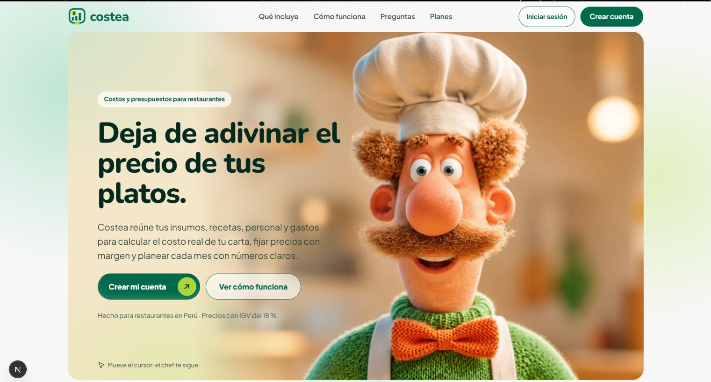
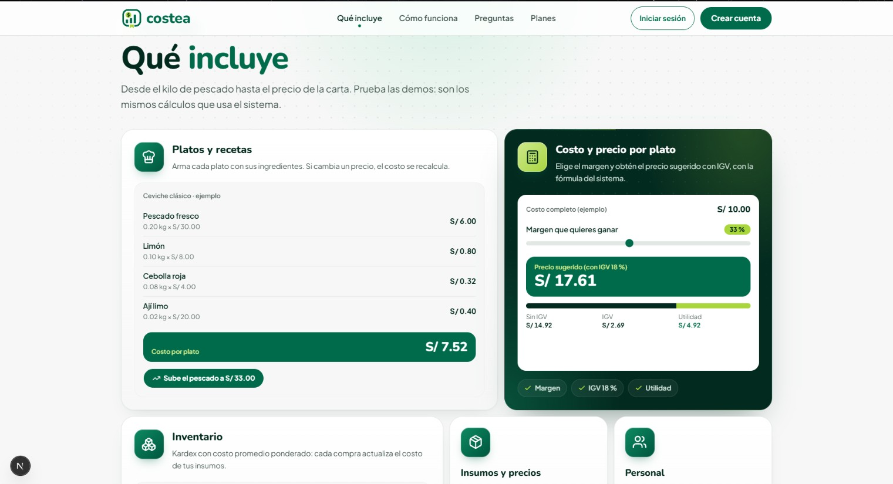
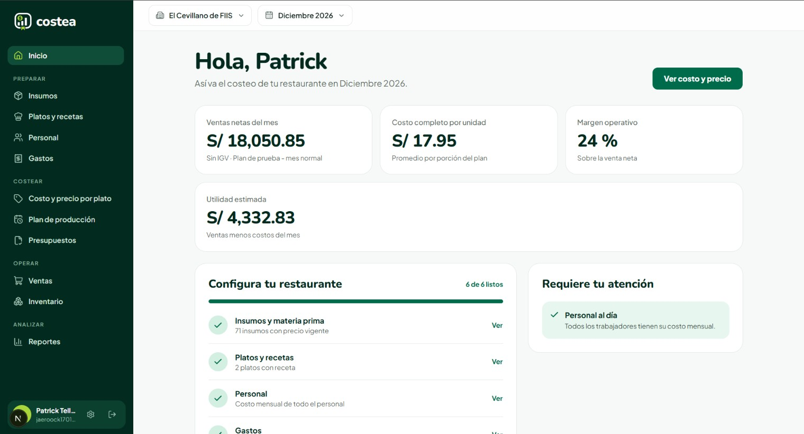
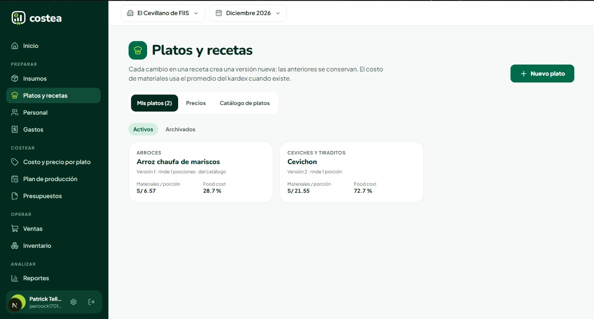
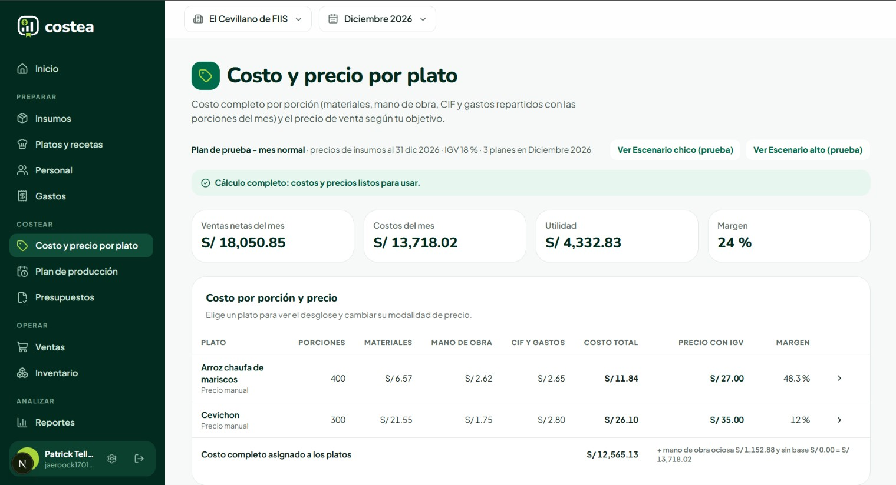
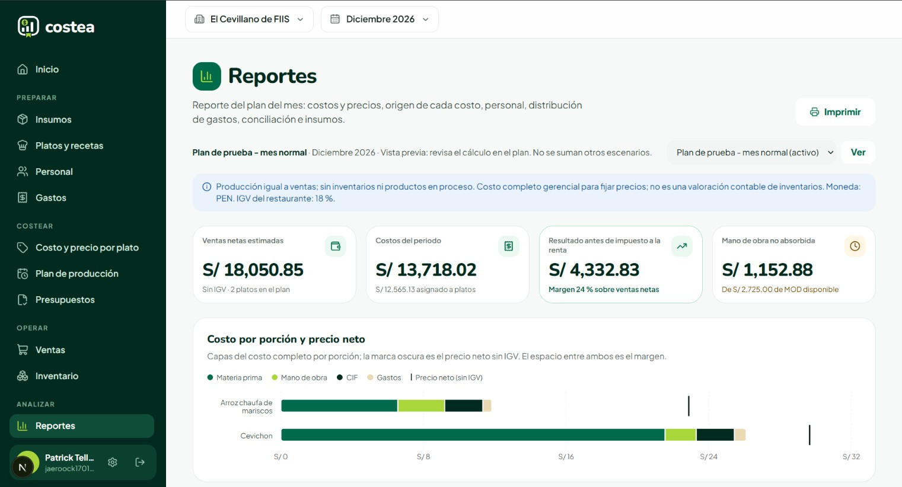

# Costea

Aplicación web para que restaurantes calculen y controlen sus costos: recetas y platos, mano de obra, gastos, planificación de producción, presupuestos, ventas e inventario. Todo en español (Perú), con moneda en soles (PEN) e IGV configurable (18 % por defecto).

Nació como proyecto del curso **Contabilidad de Costos y Presupuestos** (UNI) y se está reconstruyendo con un stack moderno y un diseño nuevo, conservando la lógica de negocio original.

## Vista previa
| | |
|---|---|
|  |  |
|  |  |
|  |  |

Los datos son de demostración.

## Qué incluye
- **Landing** que presenta los beneficios de Costea y lleva al registro o inicio de sesión.
- **Autenticación** con correo y con Google; recuperación y cambio de contraseña (Supabase Auth).
- **Módulos del sistema**, dentro de la cuenta de cada restaurante:

| Módulo | Para qué sirve |
|---|---|
| Insumos | Catálogo de materiales con versiones de precio |
| Platos | Recetas con versiones y costo por porción |
| Personal | Mano de obra y planilla |
| Gastos | Gastos indirectos y generales |
| Costos | Costeo por línea de producto |
| Planificación | Planes de producción y capacidad |
| Presupuestos | Presupuestos que, una vez publicados, no se pueden modificar; descarga del documento |
| Ventas | Registro de ventas |
| Inventario | Kardex con costo promedio ponderado y alertas de faltantes |
| Reportes | Gráficos de composición de costos, márgenes y presupuesto; versión imprimible |
| Configuración | Restaurantes, periodos, unidades de medida e IGV |

- **Varios restaurantes por cuenta**, con aislamiento de datos mediante *Row Level Security* de Postgres: cada restaurante ve solo lo suyo.
- **Cálculos monetarios exactos** con `decimal.js` (nunca `number` para dinero), con la misma lógica y casos de prueba del proyecto original.

## Stack
- **Frontend:** Next.js (App Router), React, TypeScript, Tailwind CSS 4, shadcn/ui, Lucide, Recharts y Motion para animaciones.
- **Backend y datos:** Supabase (Postgres, Auth y RLS), con migraciones SQL versionadas en `supabase/migrations/`.
- **Pruebas:** Vitest; las pruebas de base de datos usan PGlite (Postgres en memoria).

## Estructura
| Ruta | Contenido |
|---|---|
| `app/` | Páginas y rutas: landing, autenticación y `app/app/*` (módulos) |
| `components/` | Componentes de interfaz, por módulo |
| `lib/` | Lógica de negocio y utilidades |
| `supabase/` | Migraciones, scripts y pruebas de base de datos |
| `brand/`, `public/` | Logo, tokens de color y recursos visuales |
| `legacy/` | Proyecto original en Flask, solo como referencia de la lógica |
| `DESIGN.md`, `CLAUDE.md`, `AGENTS.md` | Guía de diseño y reglas del proyecto para el desarrollo asistido por IA |

## Cómo correrlo en local
Requisitos: Node.js y un proyecto de Supabase.

```bash
npm install
cp .env.example .env.local   # en Windows: copy .env.example .env.local
```

Completa `.env.local` con la URL y la clave pública (*anon / publishable*) de tu proyecto de Supabase, que están en *Project Settings → API*. Aplica en orden los archivos de `supabase/migrations/` a tu base de datos (desde el editor SQL de Supabase o con la CLI) y luego:

```bash
npm run dev      # http://localhost:3000
npm test         # pruebas con Vitest
npm run build    # compilación de producción
```

Las claves y credenciales solo van en `.env.local`, que está en `.gitignore`.

## Estado
En desarrollo. El núcleo de módulos está construido por fases; la landing y el pulido visual siguen en iteración. Los datos de demostración son ficticios.

## Créditos
Proyecto académico de la Universidad Nacional de Ingeniería (UNI), curso Contabilidad de Costos y Presupuestos.
